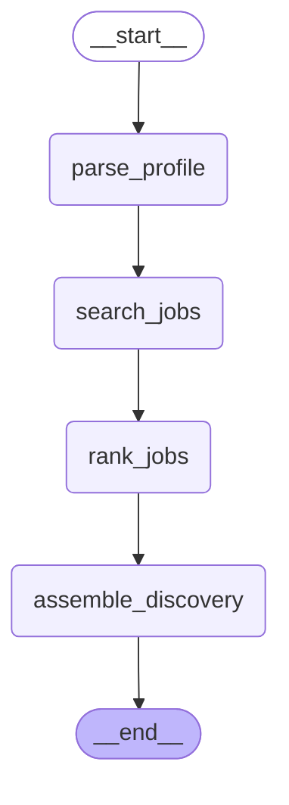
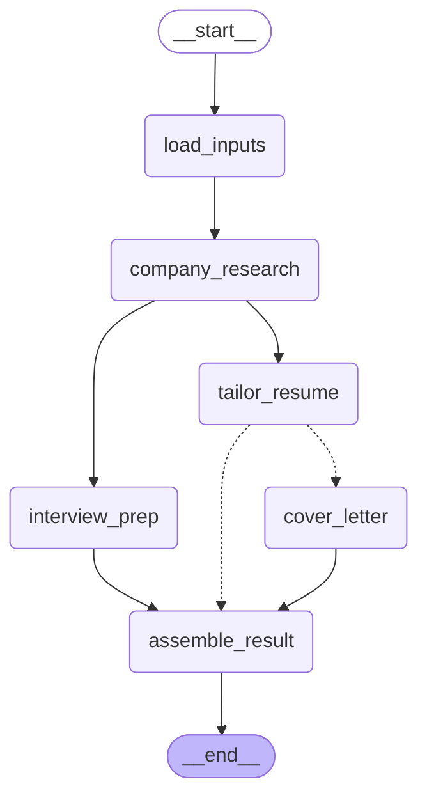

# JobPilot Orchestration Architecture

This document describes the multi-agent graph architecture of the JobPilot AI service (`apps/ai-service`). Orchestration is built using [LangGraph](https://github.com/langchain-ai/langgraph), refactored from the monolithic pipeline in `legacy/orchestrator.py` into two distinct, production-grade state graphs with persistent checkpointing, per-node error isolation, and real-time SSE progress streaming.

---

## 1. Discovery Graph (`POST /v1/graphs/discovery`)

The Discovery Graph automates the candidate job search and ranking workflow:
1. `parse_profile`: Parses uploaded resume documents (PDF/DOCX) or raw text into a structured `ParsedProfile`. If a pre-verified profile is supplied in the request, this node automatically emits a `skipped` event and passes through without re-parsing.
2. `search_jobs`: Dispatches queries concurrently across enabled job board adapters (Adzuna, RapidAPI, Greenhouse, Lever) via `JobSourceAggregator` with deduplication and rate-limiting.
3. `rank_jobs`: Executes 4-stage hybrid ranking (Hard Filtering, Lexical BM25, Dense Semantic Vector Search, Weighted Scoring, and optional LLM Reranking).
4. `assemble_discovery`: Compiles the top matching opportunities and final discovery payload.

### Generated Mermaid Diagram (Graph A)

---

## 2. Prepare Application Graph (`POST /v1/graphs/prepare-application`)

The Prepare-Application Graph coordinates tailored collateral generation for a selected job opportunity:
1. `load_inputs`: Ingests and validates the verified `ParsedProfile`, `JobPosting`, and company metadata.
2. `company_research`: Gathers intelligence via SSRF-safe website scraping and Serper search.
   - **Conditional Flow**: If company research fails or returns low confidence (`< 0.60`), the run continues without blocking, flagging `company_research_flagged = True`.
3. **Parallel Fan-Out**:
   - `tailor_resume`: Rephrases experience bullets aligning with job requirements under strict zero-fabrication constraints, running an automated double fabrication audit (`FabricationChecker`).
     - **Conditional Flow**: If the fabrication check fails twice, the tailor branch terminates immediately, routing directly to `assemble_result` and returning the flagged claims instead of the document.
     - If tailoring passes: Continues to `cover_letter`.
   - `interview_prep`: Runs concurrently with `tailor_resume`, generating STAR-grounded behavioral responses, technical questions, role questions, and reverse-interview questions.
4. `cover_letter`: Synthesizes a structured cover letter using approved tailoring facts and candidate achievements.
5. `assemble_result`: Joins the parallel branches and seals the final application preparation package.

### Generated Mermaid Diagram (Graph B)

---

## 3. Resilience, Checkpointing, and Lifecycle Controls

- **Checkpointing Keyed by `run_id`**: State snapshots are saved at every superstep by `MemorySaver`. When a run is interrupted or halted, calling `POST /v1/graphs/{run_id}/resume` resumes from the latest checkpoint without re-running completed nodes.
- **Node Isolation & Timeouts**: Every node is bounded by `wrap_node`, enforcing execution timeouts and catching exceptions so one failing node never crashes the orchestrator.
- **Real-Time Progress Streaming (SSE)**: Clients subscribe via `GET /v1/graphs/{run_id}/events` to receive ordered progress events (`queued`, `running`, `done`, `failed`, `skipped`).
- **Asynchronous Non-Blocking API**: Graph runs execute as background `asyncio` tasks managed by `GraphRunManager`, returning HTTP 202 with `run_id` immediately.
- **Process Termination**: Active runs can be killed on demand with `POST /v1/graphs/{run_id}/kill`, safely saving the state for subsequent resumption.
