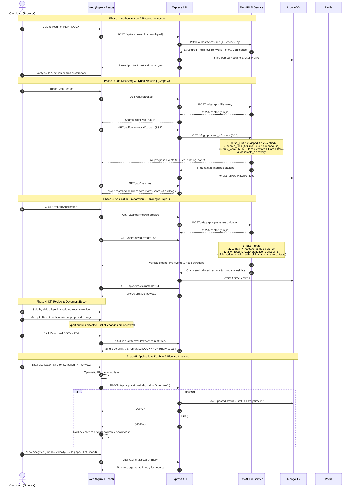
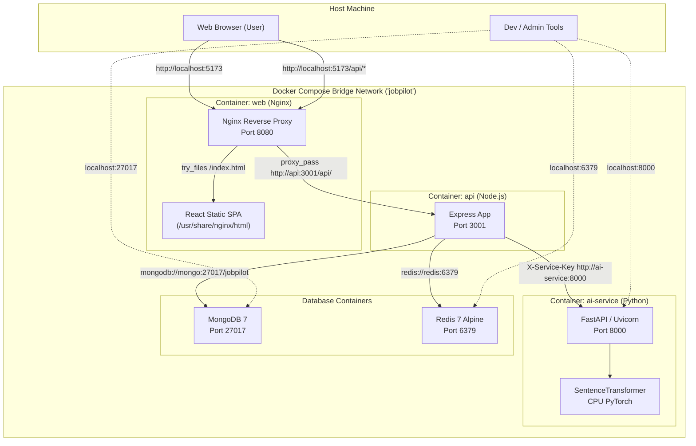

# JobPilot: Complete Project Flow & Docker Implementation Guide

This document provides a comprehensive explanation of JobPilot's system architecture, end-to-end user and data flows, inter-service communication protocols, and full Docker containerization and orchestration setup.

---

## 1. System Overview & Component Matrix

JobPilot is organized as a monorepo containing three core application services, a shared contract package, and two database backends:

```
job-hunt-agent-v2/
├── apps/
│   ├── web/               # Frontend: React 18 + Vite + Tailwind + @dnd-kit + Recharts
│   ├── api/               # Backend Gateway: Node.js 20 + Express + TypeScript + Mongoose
│   └── ai-service/        # Agent Orchestrator: Python 3.11 + FastAPI + LangGraph
├── packages/
│   └── shared/            # Shared TypeScript data models, types, and API schemas
├── docker-compose.yml     # Production-like multi-container orchestration
├── docker-compose.override.yml # Local development port mappings and hot mounts
└── docs/                  # Architecture and technical specifications
```

### Component Responsibility Matrix

| Service | Technology | Port (Internal / Host) | Primary Responsibilities |
| :--- | :--- | :--- | :--- |
| **`web`** | React 18, Vite, Tailwind CSS, Radix UI, `@dnd-kit`, `Recharts` | `8080` / `5173` | User interface: Onboarding wizard, job discovery, resume diff review, application Kanban tracker, pipeline analytics. Hosted via Nginx. |
| **`api`** | Node.js 20, Express, TypeScript, Mongoose, BullMQ | `3001` / `3001` | API gateway, JWT authentication, user sessions, MongoDB CRUD, rate-limiting, job dispatching, and SSE event proxying. |
| **`ai-service`** | Python 3.11, FastAPI, LangGraph, PyTorch (CPU), SentenceTransformers | `8000` / `8000` | Multi-agent execution graphs: Resume parsing, job scraping, 4-stage hybrid ranking, SSRF-safe company research, zero-fabrication resume tailoring. |
| **`mongo`** | MongoDB 7 | `27017` / `27017` | Persistent document storage: Users, Profiles, Resumes, Jobs, Matches, Application tracker records, Artifacts. |
| **`redis`** | Redis 7 Alpine | `6379` / `6379` | Fast caching, rate-limit buckets, BullMQ background job queues, and temporary run state tracking. |

---

## 2. End-to-End Project Workflow



### Detailed Lifecycle Stages

#### 1. Onboarding & Verified Profile
- Candidates upload their existing resume in PDF or DOCX format.
- The Node.js API streams the binary document to `apps/ai-service` via `POST /v1/parse-resume`.
- The AI service extracts contact information, structured experience items, education, and technical skills with statistical parsing confidence ratings.
- Low-confidence fields (`confidence < 0.80`) are flagged with visual review alerts on the frontend.
- When verified, candidate preferences (target role titles, locations, remote flexibility, salary minimums) are committed to MongoDB.

#### 2. Discovery Graph (Graph A)
- **Node 1: `parse_profile`**: Bypassed automatically when a pre-verified candidate profile is already present.
- **Node 2: `search_jobs`**: Queries configured job aggregators (Adzuna, Greenhouse boards, Lever boards, RapidAPI, or demo fixtures) concurrently with automatic deduplication.
- **Node 3: `rank_jobs`**: Executes a 4-tier hybrid matching pipeline:
  1. *Hard Filtering*: Excludes jobs violating strict constraints (e.g., location mismatch, mandatory clearance).
  2. *Lexical BM25*: Keyword match frequency scoring against profile skills.
  3. *Dense Vector Search*: Semantic cosine similarity via PyTorch sentence-transformer embeddings (`all-MiniLM-L6-v2`).
  4. *Scoring & LLM Evaluation*: Weighted score computation (`0-100%`) with explanation reasons and matched/missing skill gap lists.
- **Node 4: `assemble_discovery`**: Formats and returns ranked opportunities.

#### 3. Prepare Application Graph (Graph B)
- **Node 1: `load_inputs`**: Validates verified candidate profile and job requirements.
- **Node 2: `company_research`**: Fetches verifiable company data (culture, tech stack, products, news) via SSRF-safe scraping and Serper search, assigning a confidence rating.
- **Node 3: `tailor_resume`**: Rewrites resume bullet points to highlight alignment with target job specifications while enforcing strict zero-fabrication constraints. Every proposed modification contains:
  - `before` text and `after` text.
  - Strategic justification reason.
  - Traceable `source_fact_ref` linking to candidate's verified background.
- **Node 4: `fabrication_check`**: Double-audits proposed content against verified candidate profile facts. Flagged claims fail the check and prevent fabrication.
- **Node 5: `assemble_result`**: Packages the tailored resume artifact and company insights.

#### 4. Resume Diff Review & Export Guard
- **Strict Two-Tab Interface**: Displays only **Resume** and **Company** tabs (no placeholders or distractions).
- **Interactive Diff Editor**: Side-by-side view with per-bullet Accept and Reject controls.
- **Export Guard**: DOCX and PDF export buttons remain strictly disabled until every proposed modification has been explicitly accepted or rejected.
- **ATS Export Engine**: Generates single-column ATS Word documents (`.docx`) and clean PDF documents incorporating only accepted modifications.

#### 5. Applications Kanban & Analytics
- **Drag-and-Drop Board**: Tracks pipeline across `Saved`, `Applied`, `Interview`, `Offer`, and `Rejected` using `@dnd-kit`.
- **Optimistic Updates & Rollback**: Updates the UI immediately upon drop; reverts to snapshot and triggers notification if the API call fails.
- **Application Detail Side Panel**: Slides open on card click to edit applied date, manage notes, review status timeline, and download attached artifacts.
- **Pipeline Analytics**: Recharts visualizations for conversion funnels, weekly velocity, match scores by status, top 10 missing skill gaps with portfolio suggestions, and daily LLM cost tracking.
- **Follow-up Engine**: Highlights applications applied more than 7 days ago with no status change.

---

## 3. Docker Containerization Architecture

The multi-container Docker environment runs five synchronized services across an isolated bridge network (`jobpilot`):



---

## 4. Dockerfiles & Container Implementation Details

### 4.1 Frontend Container (`apps/web/Dockerfile`)

The web frontend uses a **multi-stage build**:
1. **Build Stage (`node:20-alpine`)**:
   - Copies `package.json`, workspace definitions, and lockfiles.
   - Runs `npm ci` for deterministic dependency installation.
   - Compiles `@jobpilot/shared` before building `@jobpilot/web` via Vite.
2. **Runner Stage (`nginx:1.27-alpine`)**:
   - Copies compiled SPA assets to `/usr/share/nginx/html`.
   - Copies custom [`nginx.conf`](file:///d:/AI%20Engineer/job-hunt-agent-v2/apps/web/nginx.conf).
   - Configures PID and logs in `/tmp` to allow running as non-root user `nginx`.
   - Proxies `/api/` requests to `http://api:3001/api/` with HTTP/1.1 and header forwarding.
   - Implements SPA client-side routing fallback: `try_files $uri $uri/ /index.html`.
   - Implements healthcheck endpoint at `/healthz`.

### 4.2 Backend API Container (`apps/api/Dockerfile`)

The Node API utilizes a **three-stage build** for minimal production image footprint:
1. **Deps Stage (`node:20-alpine`)**: Installs dependencies with `npm ci`.
2. **Build Stage (`node:20-alpine`)**: Compiles `@jobpilot/shared` and builds TypeScript into `apps/api/dist/`.
3. **Runner Stage (`node:20-alpine`)**:
   - Creates an unprivileged system user and group (`jobpilot:jobpilot`).
   - Copies only the production build output and runtime `node_modules`.
   - Runs `node apps/api/dist/index.js` as user `jobpilot` on port `3001`.
   - Native healthcheck executes a lightweight `fetch('http://127.0.0.1:3001/api/health')` probe.

### 4.3 AI Service Container (`apps/ai-service/Dockerfile`)

The AI service utilizes `python:3.11-slim`:
- Installs `curl` for container healthcheck execution.
- Creates an unprivileged system group and user (`jobpilot:jobpilot`).
- Installs PyTorch CPU-only wheel directly (`https://download.pytorch.org/whl/cpu`) to avoid multi-gigabyte GPU bloat.
- Installs Python dependencies from `requirements.txt`.
- Runs `uvicorn app.main:app --host 0.0.0.0 --port 8000` under non-root user `jobpilot`.
- Healthcheck probes `http://127.0.0.1:8000/health`.

### 4.4 Multi-Container Orchestration (`docker-compose.yml`)

The compose file orchestrates service dependencies, startup ordering, healthchecks, networks, and persistent storage:

```yaml
services:
  mongo:
    image: mongo:7
    volumes: [ mongo_data:/data/db ]
    healthcheck:
      test: ["CMD", "mongosh", "--quiet", "--eval", "quit(db.adminCommand('ping').ok ? 0 : 1)"]

  redis:
    image: redis:7-alpine
    healthcheck:
      test: ["CMD", "redis-cli", "ping"]

  ai-service:
    build:
      context: .
      dockerfile: apps/ai-service/Dockerfile
    environment:
      AI_SERVICE_KEY: ${AI_SERVICE_KEY}
    healthcheck:
      test: ["CMD", "curl", "-fsS", "http://127.0.0.1:8000/health"]

  api:
    build:
      context: .
      dockerfile: apps/api/Dockerfile
    environment:
      MONGODB_URI: mongodb://mongo:27017/jobpilot
      REDIS_URL: redis://redis:6379
      AI_SERVICE_URL: http://ai-service:8000
      AI_SERVICE_KEY: ${AI_SERVICE_KEY}
    depends_on:
      mongo: { condition: service_healthy }
      redis: { condition: service_healthy }
      ai-service: { condition: service_healthy }

  web:
    build:
      context: .
      dockerfile: apps/web/Dockerfile
    ports:
      - "5173:8080"
    depends_on:
      api: { condition: service_healthy }
```

### 4.5 Development Overrides (`docker-compose.override.yml`)

For local development and inspection, Docker Compose automatically merges `docker-compose.override.yml`:
- Exposes MongoDB on host port `27017`.
- Exposes Redis on host port `6379`.
- Exposes AI Service on host port `8000`.
- Mounts `./apps/ai-service/app` to `/app/app` for live Python code reload without rebuilding images.

---

## 5. Security & Network Protocols

1. **Internal Service Authentication**:
   - Communication between `api` and `ai-service` is secured using a shared symmetric secret (`AI_SERVICE_KEY`).
   - Every request from Express to FastAPI passes the key in the `X-Service-Key` header. Requests lacking a valid key return HTTP 401 Unauthorized.
2. **SSRF Protection in Research**:
   - Web scraping in `company_research` uses an SSRF-safe URL validator rejecting loopback addresses (`127.0.0.1`), private RFC 1918 subnets (`10.0.0.0/8`, `172.16.0.0/12`, `192.168.0.0/16`), and AWS/cloud metadata services (`169.254.169.254`).
3. **Non-Root Execution**:
   - All three application containers run as dedicated unprivileged users (`nginx` or `jobpilot`), adhering to container security best practices.
4. **CORS & Proxying**:
   - In production Docker, the browser communicates strictly with Nginx on port `5173`. Nginx proxies `/api/*` requests internally to the API container, mitigating cross-origin complications.

---

## 6. How to Run Locally

### Method A: Docker Compose (Full Stack)

```powershell
# 1. Build and start all 5 containers
docker compose up --build

# Or run in background (detached):
docker compose up -d --build

# 2. View streaming logs
docker compose logs -f

# 3. Stop containers and preserve database volumes
docker compose down

# 4. Stop containers and reset database volumes
docker compose down -v
```

### Method B: Native Development (Live Reload)

```powershell
# 1. Start MongoDB & Redis via Docker
docker compose up mongo redis -d

# 2. Start FastAPI AI Service (Terminal 1)
cd apps/ai-service
python -m venv .venv
.venv\Scripts\activate
pip install -r requirements.txt -r requirements-dev.txt
uvicorn app.main:app --reload --port 8000

# 3. Start Express API and Web Frontend (Terminal 2)
cd ../..
npm install
npm run dev
```
http://localhost:5173
---

## 7. Health Check & Diagnostics Reference

| Target | URL | Verification Command |
| :--- | :--- | :--- |
| **Full Stack Deep Health** | `http://localhost:3001/api/health/deep` | `curl http://localhost:3001/api/health/deep` |
| **API Health** | `http://localhost:3001/api/health` | `curl http://localhost:3001/api/health` |
| **AI Service Health** | `http://localhost:8000/health` | `curl http://localhost:8000/health` |
| **Web Nginx Health** | `http://localhost:5173/healthz` | `curl http://localhost:5173/healthz` |
| **MongoDB Status** | `localhost:27017` | `docker compose exec mongo mongosh --eval "db.adminCommand('ping')"` |
| **Redis Status** | `localhost:6379` | `docker compose exec redis redis-cli ping` |

When healthy, the Deep Health endpoint returns:
```json
{
  "status": "ok",
  "checks": {
    "api": "ok",
    "mongo": "ok",
    "redis": "ok",
    "aiService": "ok"
  }
}
```
